<p align="center">
  
</p>

<h1 align="center">Catch up with the stream while it keeps going</h1>

<p align="center">
Previously follows a Twitch stream while it happens. It listens to the streamer's microphone, reads chat and stream events, and keeps a short story of the stream with a source behind every sentence. When a raid arrives, a prepared scene in OBS tells the new viewers what they walked into. Anyone who joins late can type <code>!previously</code> in chat or open the channel's recap page. The streamer can correct a chapter or make Previously forget the last two minutes, and the change reaches every place the story appears.
</p>

<p align="center">
  <a href="https://previously-seven.vercel.app/replay"><b>Watch the example recording</b></a>&emsp;&emsp;<a href="#run-it-for-your-channel"><b>Run it for your channel</b></a>&emsp;&emsp;<a href="#how-the-story-is-built"><b>See how it works</b></a>
</p>

<!-- MEDIA: submission video. Upload the web MP4 to this repository as a GitHub attachment and put the returned https://github.com/user-attachments/assets/... URL on its own line here, with a blank line above and below. -->

<p align="center">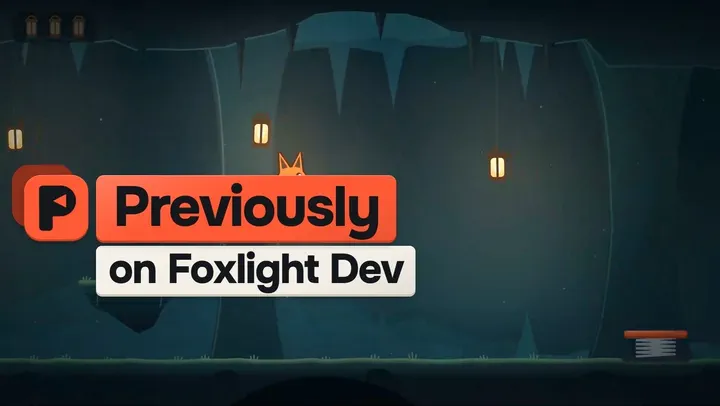</p>
<p align="center"><sub>The raid scene from the example recording, captured from the app</sub></p>

<p align="center">
  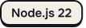
  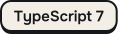
  
  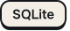
  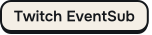
  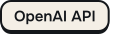
  
</p>

<p align="center">
  <a href="#what-a-raid-sees">What a raid sees</a>&emsp;<a href="#try-the-example-recording">Try the example</a>&emsp;<a href="#how-the-story-is-built">How it works</a>&emsp;<a href="#run-it-for-your-channel">Run it</a>&emsp;<a href="#privacy-and-control">Privacy</a>&emsp;<a href="#built-with-codex">Built with Codex</a>&emsp;<a href="#documentation">Docs</a>
</p>

## What a raid sees

A raid brings a group of people who have no idea what the stream is about. Regular viewers know the goal, the running joke and the bug from twenty minutes ago, while the new arrivals see only the last few seconds. Asking the streamer to stop and explain works, but it interrupts the stream every time. Previously keeps that explanation ready so it can be shown the moment they arrive.

In the example recording, Foxlight Dev is building a small cave platformer. At 1:40 a spring pad launches the fox through the ceiling and chat floods with "MOON JUMP". At 3:30 the spring gets a speed limit, and the moon jump stays in the game as a secret cheat. When pixelmoth raids with 37 viewers at 7:10, the scene walks them through the chapters with the real gameplay clips, shows chat's burst turning into the term "moon jump" and what it means, and ends on what is happening now: making the lantern behind the waterfall reachable. Then the overlay clears the screen.

<p align="center">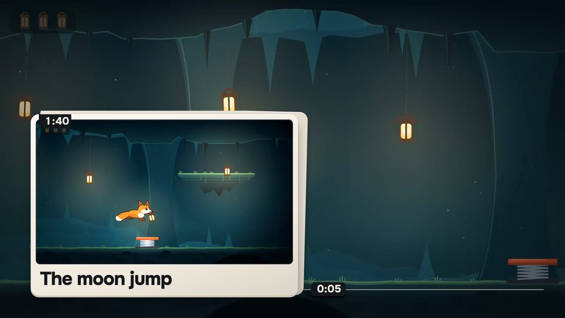 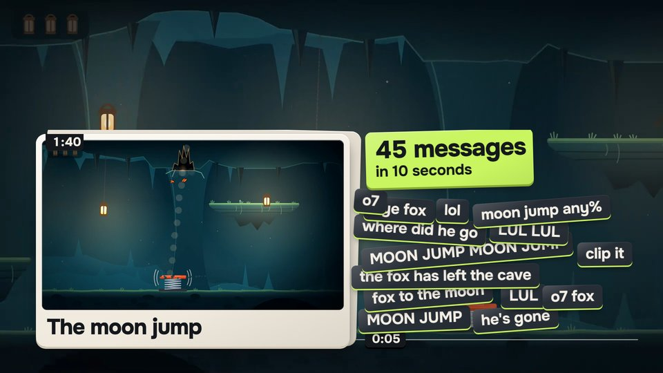 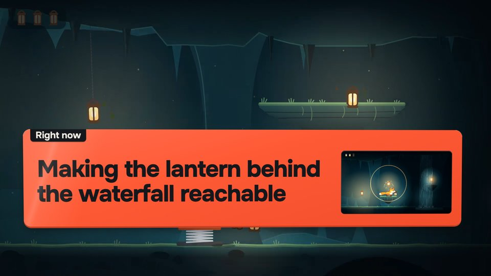</p>
<p align="center"><sub>The chapters so far, chat's moon jump burst, and what is happening now</sub></p>

The same story answers `!previously` in chat and fills the channel's public page, where a late viewer can open the source behind any chapter. Every sentence is held back for 75 seconds after its last source and checked before anyone sees it, so the streamer has time to fix or remove it first.

## Try the example recording

The [hosted example](https://previously-seven.vercel.app/replay) needs no account and no installation. It plays an eight-minute recording of the Foxlight stream through the same story rules the live app uses. The speech, chat, raid and model outcomes are written for the example, and the gameplay clips are real footage of a small game made for it.

1. **Play the recording.** The first chapter is published at 1:54, after its 75-second hold. Use 2× or 4× to move faster.
2. **Jump to the raid** runs every earlier event and then plays the raid scene.
3. In **Change the recap**, choose **Apply my wording** to rename the third chapter to "Moon jump becomes a cheat code", then **Preview the next raid scene** to see the correction in the scene.
4. Switch the recap between English and Russian, or **Open the streamer dock** and type your own wording. The recording only contains safety checks for its own wording, so yours stays held, the same way a live edit waits when a check is unavailable. **Restart** gives you a fresh run, and nothing you change leaves your tab.

<p align="center">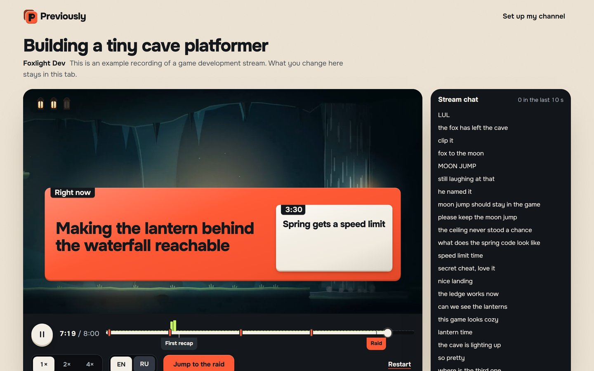 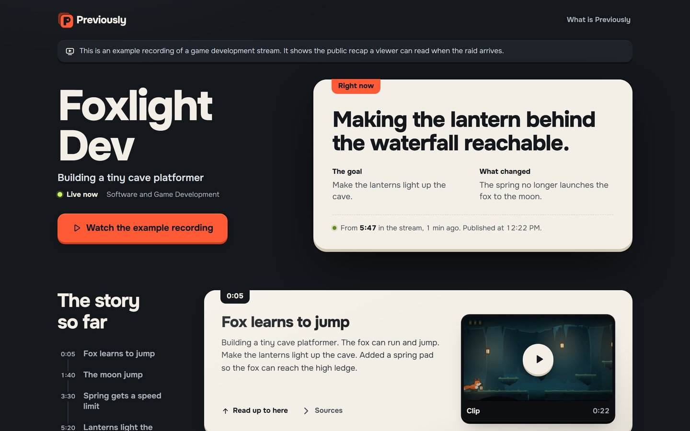</p>
<p align="center"><sub>The example replay after the raid, and the public recap page a late viewer opens from chat</sub></p>

To run the same example on your own computer (Windows, Node.js 22.13 or newer, npm), open PowerShell in the folder with `package.json`:

```powershell
npm ci
if (!(Test-Path -LiteralPath .env)) { Copy-Item -LiteralPath .env.example -Destination .env }
npm run setup:local
npm run build
npm run replay
```

`setup:local` creates the missing local secrets and a localhost certificate without touching values you already set. Accept the Windows prompt to trust **Previously localhost development** for your user, then open [https://localhost:4317/replay](https://localhost:4317/replay). The local replay makes no calls to Twitch or OpenAI and needs no OBS or FFmpeg. `/health` answers `{ "alive": true }` once the server is up. Stop it with **Ctrl+C** before starting the live app.

## How the story is built

<picture>
  <source media="(prefers-color-scheme: dark)" srcset="docs/readme/how-it-works-dark.svg">
  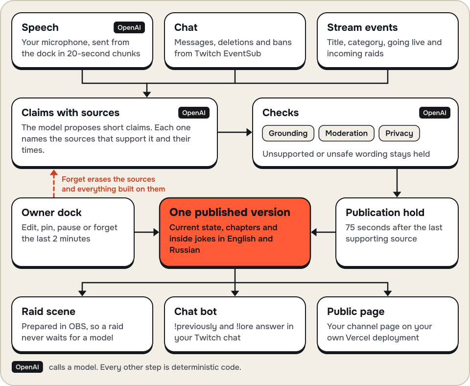
</picture>

<sub>Everything runs on the streaming computer except the model calls and the optional public page on Vercel.</sub>

The model's job is narrow. OpenAI transcribes speech, proposes claims and chapter wording that point at their sources, and checks grounding, privacy and moderation. Code on the streaming computer does the rest. It validates every proposal against the current source revisions, language and privacy state, waits out the hold and commits one published version. A model response cannot publish anything by itself, and a result that arrives after Forget cannot bring the removed text back.

Every output reads that one published version. The raid scene is prepared from it in advance, so a raid starts the scene without waiting for a model. Chat replies and the public page read the same version, and when the streamer edits or forgets something, the old wording is withdrawn from all of them.

Chapters do not follow a fixed shape. A chapter carries a goal, a change or an open question only when the speech supports it, a chat reaction alone cannot establish that a bug was fixed, and a phrase becomes a channel term only when its origin is in the sources. Long streams stay bounded: the working context keeps up to 500 recent sources, with room reserved for recent speech so a chat flood cannot push it out, and older chapters and terms stay in SQLite where they are retrieved by page or by exact mention.

Replay runs the same story core in a browser worker with recorded model outcomes and a simulated sink, so it can never post to chat or create a clip. The [architecture notes](docs/architecture/README.md) go through each boundary in detail.

## Run it for your channel

The live path has been built against the current official Twitch, OpenAI and Vercel contracts and tested with fixtures and the official Twitch CLI. It has not yet been run on a real broadcast with a real OpenAI key, so your first stream is also its first live test. The [troubleshooting page](docs/troubleshooting.md) lists the failures it knows how to report.

You need Windows, Node.js 22.13 or newer, a modern desktop browser, OBS, your Twitch account and a second Twitch account for testing chat and raids. FFmpeg and FFprobe on `PATH` are only needed for clip video.

1. **Register a Twitch application** at the [Twitch developer console](https://dev.twitch.tv/console/apps). Twitch requires two-factor authentication on that account. Choose client type **Confidential**, add exactly `https://localhost:4317/auth/twitch/callback` as the only redirect URL, then create a secret.
2. **Create an OpenAI API key** in a project that has credit and can use `gpt-transcribe`, `gpt-6-luna` and `omni-moderation-latest`. Optional narration also uses `gpt-realtime-2.1-mini`.
3. **Install and configure** with the commands above, then fill these values in `.env`:

   | Variable | Value |
   | --- | --- |
   | `TWITCH_CLIENT_ID`, `TWITCH_CLIENT_SECRET` | From your Twitch application |
   | `TWITCH_CHANNEL_LOGIN` | Your broadcaster login in lowercase, without `@` |
   | `OPENAI_API_KEY` | Your key |
   | `OPENAI_PAID_CALLS_ENABLED` | `true`. The key alone sends nothing. |
   | `RECAP_PUBLIC_ORIGIN` | Optional. Your Vercel deployment, so chat replies include a link to the recap page. |

4. **Start the live app** with `npm run build` and `npm start`, and keep the terminal visible. A rejected key, a missing model or an account without credit prints one `[previously] OpenAI ...` line with the fix.
5. **Connect Twitch** at [https://localhost:4317/setup](https://localhost:4317/setup) and sign in as the broadcaster from `TWITCH_CHANNEL_LOGIN`. Tokens are encrypted in the local database; never paste them into `.env`.
6. **Go live in OBS**, then choose **Check again** in setup until the stream session appears. Connecting the account does not start a session; only a live stream does.
7. **Open the dock** at [https://localhost:4317/dock](https://localhost:4317/dock) in a normal browser tab. Listening starts paused, so choose **Resume listening** or **Start microphone**, allow the microphone and leave the tab open.
8. **Add the scene to OBS.** In setup, choose **Copy OBS overlay URL** and add it as a 1920 × 1080 Browser Source. The URL grants access to your overlay, so keep it private.

The first chapter needs about two to three minutes of talking, because speech is sent in 20-second chunks and each sentence waits out the hold and its checks. From the second account, `!previously` gets the latest chapters, or a note that the first recap is still being prepared. To test a raid, type `/raid <your login>` in the second account's own chat while your channel is live. All paid calls share a $4.50 ceiling stored in the local database, and every call reserves more than it is likely to cost, so the ceiling is reached well before $4.50 of real spend.

[Local setup](docs/setup/local.md) explains each step in more detail, and [your first stream](docs/setup/first-stream.md) walks through a complete test stream from a private OBS check to a reviewed replay.

## During the stream

Chapters appear in the dock once their checks and hold are done. You can open the source behind a chapter, edit its wording or pin it for the next scene. **Preview** plays the scene only in the dock, and **Show recap** plays it in OBS. The dock's keyboard shortcut works while the dock has focus.

The scene lasts 10, 12 or 15 seconds, set in **Scene settings** along with its position and the areas it must not cover. Before there is enough story, a raid gets a 5-second welcome, which can use your own short context and an approved clip from a previous stream, labelled as such. One scene plays at a time and one more can wait; later raids join that waiting welcome. **Show a recap when a raid arrives** is on by default, and your Twitch incoming raid settings still apply.

Viewers get two chat commands. `!previously` replies with the current context, and `!lore TERM` explains a channel term when a checked explanation exists. Each viewer has a 30-second cooldown, the bot sends at most one message every 10 seconds, and it ignores its own replies. **Save moment** marks a moment even when chat is quiet. Automatic Twitch clips stay off until you allow them in scene settings, and optional VOD markers need `TWITCH_MARKERS_ENABLED=true` and a reconnect.

## Privacy and control

Nothing is shown until it has passed its checks and the hold, and the streamer can change or remove it at any point. These are the controls in the dock and what each one does.

| Control | What happens | What it cannot undo |
| --- | --- | --- |
| **Pause listening** | Stops the microphone, unsent audio and new speech and chat collection at once, then confirms the pause with the server. **Retry pause** keeps the device stopped if confirmation fails. | Speech already uploaded may still finish until the server confirms. |
| **Forget last 2 min** | Erases the sources from that window and everything built on them: chapters, terms, translations, clips in the local cache, queued scenes, recordings and exports. Pins do not protect anything, and a late model reply cannot restore it. | A Twitch clip may already exist, because Twitch creates clips immediately. Previously hides it and gives you a link to delete it in the [clip manager](https://dashboard.twitch.tv/content/clips). |
| **Edit** | Withdraws the old wording everywhere at once, checks your wording and protects it from later automatic rewrites. A safe correction does not wait for another full hold. | People who already read the old wording. |
| **Pin** | Gives a chapter priority in the next scene. It never skips a safety or privacy check. | |
| **Delete** | Removes the chapter and keeps its sources, so Forget is still available for them. | |

If you run a public page and the collector is offline, a removal waits until the cloud acknowledges it. Downloaded ZIP files, copied footage or screenshots, Git copies and other people's recordings cannot be recalled by Previously.

<p align="center">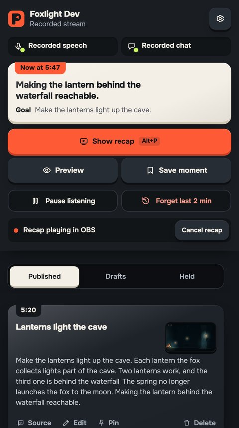 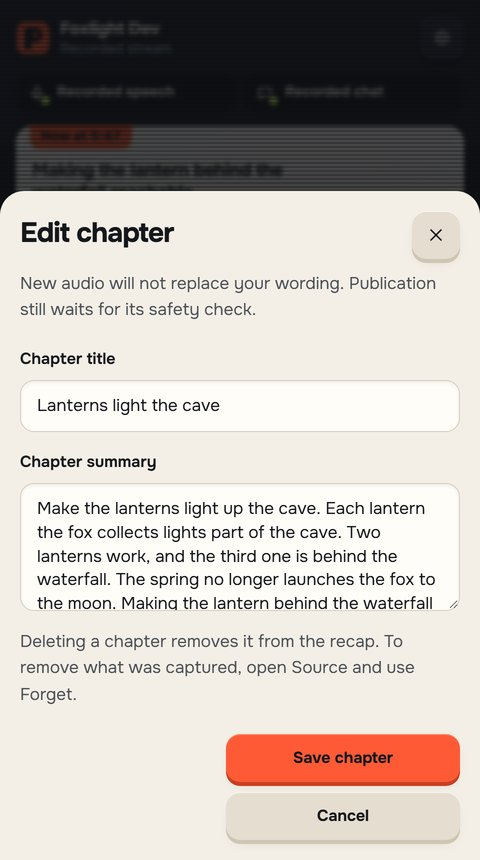 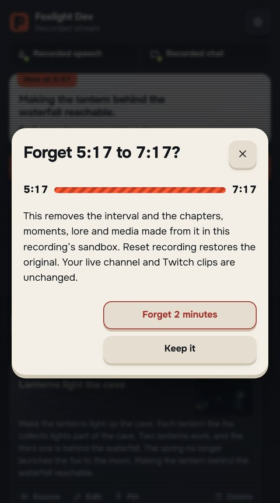</p>
<p align="center"><sub>The streamer dock with its published chapters, correcting a chapter, and forgetting the last two minutes</sub></p>

## Recordings and your viewer page

A stream can be recorded privately and replayed later with the same story rules, downloaded as an offline ZIP or published as a replay on your viewer page. The dock walks you through arming the recording, reviewing every source and saved sentence, approving it, exporting and withdrawing it again. [Recordings](docs/recordings.md) explains the steps and the size limits.

The public recap page is optional. You deploy this repository to your own Vercel project with a private Blob store, and the collector sends it only published, permitted content through signed requests. The page never receives transcripts, microphone audio or tokens, and it hides live content when the collector stops renewing it. [Viewer page hosting](docs/setup/publication.md) covers the deployment, its variables and the publication API.

## Built with Codex

Previously was built in one OpenAI Codex session: the product research, the architecture, the code and the tests. Parallel Codex workers each owned one part (the runtime, storage, Twitch adapters and the interface), and the main session joined them, reviewed the joins and checked the user journeys. VibeMachina, a set of planning, design and review instructions, guided the work; it is not part of the runtime. Claude agents made the final visual pass, which covers the new mark, the rebuilt raid scene and pages and the Foxlight example, and wrote this README.

Reviews and long runs found real bugs, and each one now has a regression test:

- A full chat queue could drop a message deletion that had already arrived. Privacy controls now go through a durable inbox that survives a crash.
- A failed microphone pause reported success, and speech could still be committed after the pause. The pause is now confirmed by the server and retried while the device stays off.
- A delayed Twitch token check could restore credentials after the streamer had disconnected.
- After a model outage in a long run, chat pushed recent speech out of the working context and chapters stopped updating for a long time. Recent speech now has reserved room.

The measurements below ran on 2026-11-02 on one Windows 10 machine with Node 22.13. The machine was busy with other work at the time, so treat the timings as rough. They use local fixtures in place of Twitch sockets and the OpenAI API.

| What was measured | Result |
| --- | --- |
| Chat intake through the real EventSub transport, runtime and SQLite | 1,000 of 1,000 messages committed at 20 per second with no gaps. Receive to commit p95 was 49.84 ms. |
| Story reducer alone, eight virtual hours at 20 chat messages per second with a one-minute burst at 200 per second | 577,200 messages with no limit violations. At most 500 sources were kept and the largest evidence packet was 2,034 bytes. |
| Full engine with file-backed SQLite on the same eight-hour profile | Stopped early at 3.80 virtual hours with 280,780 chat messages, including the whole burst. Integrity checks passed, and all 42 freshness checks in the last saved sample were met. The eight-hour run was not completed. |

The three runs, in the same order, from the project folder:

```powershell
node --import tsx scripts/verify/chat-intake-benchmark.mts 20 1000
node --expose-gc --import tsx scripts/stress/virtual-stream.mts 28800 docs/testing/reliability/virtual-full-core.json core 20
node --expose-gc --import tsx scripts/stress/engine-full-profile.mts 28800 docs/testing/reliability/engine-repaired-full.json normal
```

The [reliability report](docs/testing/reliability/README.md), [chat intake measurement](docs/testing/functional/chat-intake-2026-11-02.md) and [release preflight](docs/testing/functional/release-preflight.md) record the exact scope of each run.

## Verification and limits

```powershell
npm run check
npx tsx docs/setup/verify-keyless.mts
```

`npm run check` typechecks, runs the test suite and builds the local and public clients. The keyless probe starts an isolated HTTPS server with a temporary database and blocked network access, then checks readiness, the example replay's integrity, its first chapter and its raid plan. It can run next to a running collector.

These limits apply to the current version:

- The local HTTPS setup is Windows only, and one running instance serves one broadcaster.
- The interface is in English. Recaps can be English or Russian, and speech is transcribed in the language it was spoken.
- Converting oversized recording video needs FFmpeg with `h264_nvenc` and an NVIDIA GPU; there is no software fallback.
- Quality of the model's transcription and wording, clip alignment and broadcast sound depend on your setup and still need checking with it.
- No viewer retention or comprehension result is claimed.

## Documentation

| Page | What it covers |
| --- | --- |
| [Local setup](docs/setup/local.md) | Install, certificate, Twitch connection, microphone, OBS scene and clips |
| [Your first stream](docs/setup/first-stream.md) | A complete test stream with a second account, a raid and a reviewed replay |
| [Configuration](docs/setup/configuration.md) | Every environment variable, model names, the budget ceiling and what is stored where |
| [Recordings](docs/recordings.md) | Recording, review, export, sharing, withdrawal and their limits |
| [Viewer page hosting](docs/setup/publication.md) | Vercel deployment, private Blob store, cloud variables and the publication API |
| [Troubleshooting](docs/troubleshooting.md) | Symptoms and fixes, backups and the media cache |
| [Architecture](docs/architecture/README.md) | Module boundaries, evidence, privacy, publication and scene playback |
| [Replay reference](docs/replay/README.md) | The example bundle, replay format, owner recording API and offline helpers |
| [Provider notes](src/server/providers/README.md) | How the OpenAI adapters call each model and handle failures |
| [Test evidence](docs/testing/final/requirements.md) | Requirements against the evidence that covers them |

## Materials and licenses

The interface uses the [Onest](public/fonts/OFL-Onest.txt) typeface under the SIL Open Font License. The [brand assets](public/brand/) come from one outlined SVG master. The Foxlight gameplay clips in `public/demo/foxlight` are recorded from a small original browser game made for the example, whose source is in `tools/foxlight`. The live app uses Twitch EventSub and Helix, the OpenAI API and, for the optional public page, Vercel Functions and Vercel Blob; each needs your own account.
