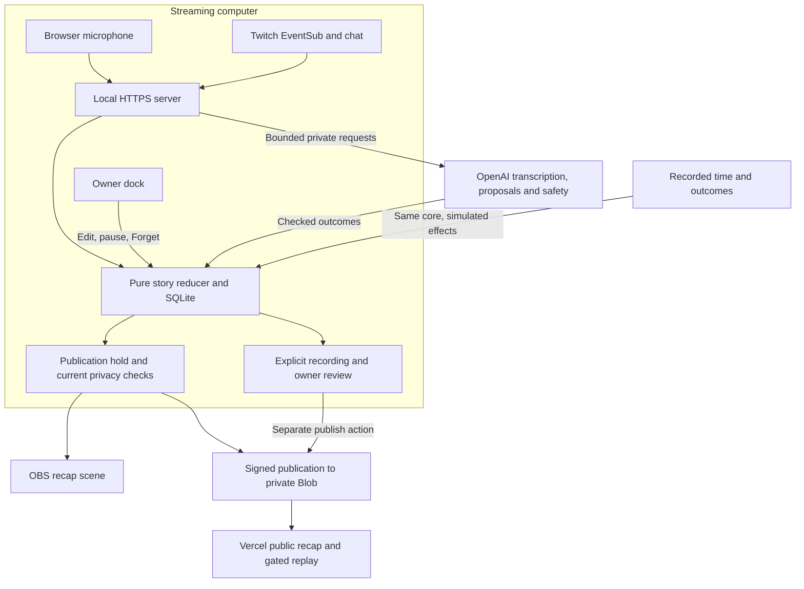

<p align="center"></p>

# Catch up with the stream while it keeps going

Previously gives late Twitch viewers the context behind the current moment. It turns spoken context and chat evidence into a short, editable stream history, then uses the published story to welcome an incoming raid in OBS. The streamer controls listening, corrections, and what gets forgotten.

[Open Previously](https://previously-seven.vercel.app) | [Try the hosted authored example](https://previously-seven.vercel.app/replay) | [Source repository](https://github.com/DarinaX2005X/previously-codex-twitchcon-project)

<p align="center"><a href="#try-without-accounts">Try without accounts</a> | <a href="#connect-your-channel">Connect your channel</a> | <a href="#listen-and-add-the-obs-scene">OBS and microphone</a> | <a href="#publish-the-public-recap">Public hosting</a> | <a href="#record-review-and-share">Recordings</a> | <a href="#configuration">Configuration</a> | <a href="#recover-and-troubleshoot">Recovery</a> | <a href="#how-it-works">Architecture</a> | <a href="#verification-and-limits">Verification</a></p>

## Arrive in the middle and understand what changed

A late arrival needs more than the latest chat reaction. Previously keeps source-backed context available while the streamer continues, with chapters, source times, permitted moments, and explanations of channel-specific phrases when the evidence supports them. A raid uses an already prepared scene instead of waiting for a new story request.

The included example follows a saved note whose preview is empty:

> “I am making notes survive a reload. The saved note is still in storage, but the preview is empty. I am checking the preview renderer.”

The chapter can explain that investigation without declaring it fixed. Other streams can describe a performance, conversation, game, or any supported context without a required goal/problem/fix arc. A stream does not need a joke or lore entry to have a useful recap.

<p align="center"></p>
<p><sub>Captured from the running product with illustrative authored text. No captured Twitch footage or actual model responses are shown.</sub></p>

The owner can inspect sources, edit or pin chapters, save moments, and remove material. A correction immediately withdraws the previous public wording and waits for its own checks. The same accepted wording feeds the public page, bot, and next recap. English and Russian are separate checked recap presentations; recognition preserves the source language. The interface is English.

## Try without accounts

The supported local certificate setup uses **Windows, Node.js 22.13 or newer, and npm**. Clone or download the repository and open the directory containing `package.json` in PowerShell:

```powershell
npm ci
if (!(Test-Path -LiteralPath .env)) { Copy-Item -LiteralPath .env.example -Destination .env }
npm run setup:local
npm run build
npm run replay
```

The setup command generates missing local secrets and a localhost certificate without replacing nonempty settings. Confirm the **Previously localhost development** trust prompt for your Windows current user. The PFX is stored in `.data/tls`; keep it with its generated passphrase. Use [https://localhost:4317/replay](https://localhost:4317/replay).

This authored, text-only example needs no Twitch, OpenAI, or Vercel account. It runs without OBS or media tools and makes no live provider calls:

1. Choose **Play recording**. The source starts at recorded time **0:01** and its first chapter publishes at **1:16**, after the 75-second source hold. **4×** changes recorded time, not measured live latency.
2. Choose **Jump to raid** to replay the preceding events and show the welcome scene.
3. Choose **Apply correction**, then **Preview next recap**. English and Russian select the example's checked presentations.
4. Open the **demo dock** to edit your own wording. An edit without an exact recorded safety outcome stays held. **Restart** creates a fresh isolated run.

Normal startup binds loopback at `https://localhost:4317`. `/health` returns `{ "alive": true }`; `/ready` reports storage/process readiness. `configuration: "incomplete"` is expected in keyless mode. Stop with **Ctrl+C** before switching to the live process.

## Connect your channel

Use your own broadcaster account, following [Twitch's account creation guide](https://help.twitch.tv/s/article/creating-an-account-with-twitch) if needed. Create an application in the [Twitch developer console](https://dev.twitch.tv/console/apps), select the **Chat Bot** category, and register this exact redirect URL without an extra empty redirect field:

```text
https://localhost:4317/auth/twitch/callback
```

Set `TWITCH_CLIENT_ID`, `TWITCH_CLIENT_SECRET`, and `TWITCH_CHANNEL_LOGIN` in your local `.env`. The login is the broadcaster's name without `@` or a URL. For new speech and story checks, also set your server-side `OPENAI_API_KEY` and explicitly choose `OPENAI_PAID_CALLS_ENABLED=true` when you intend to run paid requests. Leave it `false` during account preparation or replay. Restart after environment changes.

Run the built live app:

```powershell
npm start
```

Open [local setup](https://localhost:4317/setup), choose **Connect Twitch**, and authorize the configured broadcaster. Tokens are obtained through that flow and encrypted in SQLite; do not paste tokens into `.env`. Connection alone does not start a stream or microphone.

The flow requests `user:read:chat`, `user:write:chat`, `clips:edit`, `channel:manage:clips`, `channel:moderate`, and `moderation:read`. Chat replies use the broadcaster identity; there is no separate bot-account configuration. Optional VOD markers use `TWITCH_MARKERS_ENABLED=true` and require a restart plus reconnect to grant `channel:manage:broadcast`.

The current adapters use `gpt-transcribe`, `gpt-6-luna`, `omni-moderation-latest`, and optional `gpt-realtime-2.1-mini` narration. These model IDs and the **$4.50 persistent dispatch ceiling** are fixed in code. Each paid attempt reserves budget before dispatch; restarts do not reset reservations or usage, and an ambiguous timeout can retain its allowance. A configured key does not establish account access to those models. Narration is off by default and is enabled in scene settings, not an environment variable.

## Listen and add the OBS scene

Use a modern desktop browser with microphone permission and AudioWorklet support. OBS puts the scene on stream. **FFmpeg and FFprobe on `PATH`** are needed for clip validation and prepared audio. Converting oversized recording video also needs a working **`h264_nvenc` encoder and compatible NVIDIA GPU/driver**; there is no software encoder fallback. The text-only replay needs none of those media tools.

1. Prepare OBS using **Tools → Auto-Configuration Wizard**, then select Twitch under **Settings → Stream** and connect your channel. Choose an accurate title/category in Twitch's Creator Dashboard. Add your intended sources, choose the microphone, inspect Audio Mixer meters, and play back a short local recording before broadcasting. See the [OBS Quick Start Guide](https://obsproject.com/kb/quick-start-guide).
2. For a development stream, select an editor/application with **Window Capture**. It captures the chosen window even behind another window; private content inside that application can still appear. Inspect the actual preview. See [OBS Window Capture](https://obsproject.com/kb/window-capture-sources).
3. In a setup tab, choose **Copy OBS overlay URL**. Add the complete private URL as a **1920 × 1080 Browser Source** above the captured content. Its fragment grants overlay access. **Rotate link** invalidates old access and requires updating OBS. See [OBS Browser Source](https://obsproject.com/kb/browser-source) for URL and viewport properties.
4. Open [the dock](https://localhost:4317/dock) in a normal browser tab. If you want a replay of this stream, choose **Recordings → Arm next recording** before starting the stream. Confirm the armed header state. Recording cannot recover an earlier session prefix.
5. Start streaming in OBS, confirm the Twitch channel is live, and use **Check configuration** in the separate setup tab until the session appears. In the dock, choose **Resume listening** when paused, or **Start microphone** when listening is enabled but the microphone is off. Grant access to the intended device. Keep this producing dock tab open; open setup/public links in other tabs.
6. Use **Preview** in the dock locally, then **Show recap** for the connected OBS source. The shortcut works only while the dock has focus. In **Scene settings**, choose scene length/position, protected areas, automatic raids, and optional sound/narration. Enable OBS audio control for that Browser Source and verify its mixer routing. Avoid duplicating your microphone through the overlay.

You can add the dock through **OBS Docks → Custom Browser Docks**, but use the normal browser capture tab if the embedded browser cannot grant microphone access. An OBS Browser Source is not the microphone producer. If another tab owns the capture lease, **Take over listening** deliberately stops that producer and listens here.

Scene settings offer 10, 12, or 15 seconds for the full recap. An early welcome without enough supported context lasts 5 seconds. Optional **Context for an early welcome** and an approved **previous-stream clip** help before chapters exist; setup provides **Preview previous clip** and **Use previous clip**. That footage is labelled as belonging to a previous stream. A welcome still works without video. One scene plays while one welcome waits; later arrivals merge into that bounded queue.

### A first real session

A 20–40 minute stream of your own work or conversation is one useful route. Speak naturally about what happens. Wait for an actual checked, published chapter: the default 75-second hold starts at the end of supporting material, with processing and checks in addition. From a second Twitch account, send `!previously` in the receiving channel's chat; `!lore TERM` returns a checked explanation when available. Open public links separately so capture stays active.

Use **Save moment** on a genuine moment. Automatic clip creation is off until **Allow automatic Twitch clips** is selected in scene settings. A moment can retain only a timecode when Twitch clips are unavailable. Inspect a ready official clip separately from the saved marker. Optional Twitch stream markers require a live broadcast, enabled VOD storage, and their additional scope; requests expire after 60 seconds rather than marking a later point. An unavailable marker preserves the timecode. See [Twitch Create Stream Marker](https://dev.twitch.tv/docs/api/reference/#create-stream-marker).

To receive a real raid, use a second channel you control or a willing sender. Affiliate/Partner status is not required. In the **sender's own channel chat**, enter `/raid YOUR_RECEIVING_LOGIN`, then follow Twitch's countdown and **Raid Now** control. A `!raid` message in the receiving channel does not initiate it. If rejected, inspect Twitch's restriction notice and recipient settings: viewer thresholds, sender account age, and permitted groups can exclude a new test account; changed minimum/maximum viewer limits also block offline senders. Resolve that specific mismatch with an eligible sender and the recipient's intended safety settings. See [Twitch's raid guide](https://help.twitch.tv/s/article/how-to-use-raids?language=en_US).

## Publish the public recap

The collector stays on the streaming computer. Vercel hosts the viewer client and signed publication functions, backed by **private Vercel Blob storage**. Viewers receive gated published content, not direct Blob URLs, private transcripts, microphone uploads, or OAuth tokens.

1. Import this repository into Vercel with the directory containing `package.json` as project root. [`vercel.json`](vercel.json) sets `npm run build:public`, output `dist-public`, and API routing. Use a Node runtime compatible with Node 22.
2. Create/connect a **private** Blob store. Add these variables to the deployment's server environment:

| Cloud variable | Value |
| --- | --- |
| `TWITCH_CHANNEL_LOGIN` | Actual broadcaster login this deployment may serve |
| `PUBLISH_SHARED_SECRET` | Same generated secret as the local collector, at least 32 bytes |
| `BLOB_READ_WRITE_TOKEN` | Token for the private store, kept server-side |

3. Redeploy after environment changes. Locally set `RECAP_PUBLIC_ORIGIN` to the deployment's HTTPS origin without a trailing slash and use the matching `PUBLISH_SHARED_SECRET`; restart the collector.
4. Open the public channel address shown in setup, `/c/<channel-login>`. The first signed publication binds that login to its numeric Twitch identity. Use your actual broadcaster identity, not a verification fixture.

The local durable outbox sends snapshots and privacy retractions automatically. The signature covers the exact operation body; conditional cloud writes reject stale/conflicting revisions. A local save remains pending until its matching cloud acknowledgement. Keep the collector running while a live recap needs heartbeat renewal and while edits, exports, or withdrawals await confirmation. A cloud snapshot is bounded at 1,000,000 bytes; the current channel head retains at most 100 episode pointers and 10 export manifests.

A live snapshot has a 30-second server lease. Public clients remove stale content when visibility validation fails. A finalized episode can remain readable after the collector stops. Replay manifests poll every two seconds and expire after six seconds without successful validation; public replay therefore needs connectivity. HTTP page availability alone does not prove a replay manifest is available. Publish your reviewed recording below to obtain its own link. The optional [authored-example registration script](scripts/publish-authored-replay.mts) is an explicit administrative action, documented in the [publication reference](docs/setup/publication.md); page loads never register or restore revoked exports.

## Record, review, and share

The recorder saves private normalized context and exact checked provider outcomes for replay. It does not record the desktop or automatically attach raw microphone audio. Keep separate OBS screen/audio recordings outside Git and review their visible content and sound before sharing.

<p align="center"></p>
<p><sub>Captured from the local owner review with illustrative authored fixture content. This is not evidence of a recorded Twitch broadcast.</sub></p>

1. Before the session collects context, open **Recordings → Arm next recording**. **Start private recording** is available only when the server confirms the current session has no earlier context. The header keeps armed/recording state and **Stop recording** accessible after you close the sheet.
2. Capture a checked story and let a chapter publish. When finished, **Pause listening**, confirm the pause, then **Stop recording**. You can end the Twitch broadcast and separate OBS recording while keeping the collector running for publication acknowledgements. Export needs a complete stopped prefix, unchanged safe sources, completed recorded text checks, and deterministic replay that reaches a published chapter. A raid, correction, second language, or media asset is optional.
3. Open **Review contents**. Review the metadata, every source excerpt, and all saved text fields, paging through longer lists. Select optional ready media from this recording's validated cache and watch/listen to its actual prepared bytes. Confirm both visual and audio checks; text moderation cannot inspect a secret on screen. Arbitrary local paths or uploads cannot be attached.
4. Choose **Approve reviewed contents**, then **Create private export**. Changes to media preserve checks only for exact unchanged content, and always require fresh approval for the new revision. An exported package cannot be edited in place.
5. **Download offline ZIP** provides `manifest.json`, an assembled `bundle.json`, and selected media after acknowledgement that the copy cannot be remotely recalled. It is a data/media package, not a standalone HTML player. The programmatic [`replayOffline`](src/server/replay/offline.ts) helper supports ZIP and JSON without provider calls.
6. **Publish recording** separately uploads reviewed assets and a signed manifest. Wait for **Open published recording**; only that export's exact acknowledgement enables its public link. **Retry publication** is available when confirmation fails.
7. **Withdraw recording** closes managed local replay/download access immediately and queues public withdrawal. Keep the collector running until acknowledged; use **Retry withdrawal** if needed. **Remove recording** is enabled after any required public withdrawal acknowledgement. Stream chapters remain in place because this withdraws the export, not its original sources.

These capacity limits determine what can be recorded/exported; they are not stream-duration guarantees:

| Recording item | Limit |
| --- | --- |
| Retained private recordings | 20 |
| Private capture | 32,000,000 bytes; 10,000 events; 10,000 provider outcomes; 100 media candidates |
| Selected media | Up to 12 assets, each at most 3,000,000 bytes and 120 seconds |
| Public package | Up to 100 assets and 32,000,000 declared bytes including selected media |
| Offline ZIP | 32,000,000 bytes including assembled JSON, manifest, media and archive overhead |

Larger cached video is prepared with `h264_nvenc`; audio may be prepared as MP3. A failed conversion stays unselected. Reaching a capture limit fails the capture instead of silently discarding context. A process restart marks an active capture interrupted; it cannot resume or export. Public replay only offers raid/correction/language controls present in that recording. Deep bundle and owner API contracts are in the [replay reference](docs/replay/README.md).

## Correct the story and control privacy

**Edit** withdraws the old published chapter wording immediately, holds the owner statement for checks, and protects it from later automatic generation. A safe correction does not begin another full source hold. **Pin** changes selection priority without bypassing safety or privacy. **Delete** removes the chapter while retaining its captured sources.

**Pause listening** immediately stops the microphone, incomplete samples, and queued local audio, then confirms the server pause of new speech/chat collection. Connection/deletion/control events still run. If confirmation fails, **Retry pause** keeps the device stopped while retrying; already uploaded speech may still finish until confirmation. **Forget last 2 min** is the separate action for accepted source material and all dependent chapters, lore, media, queued playback and exports. Pins do not protect forgotten material.

Forget invalidates the private capture. Keep a disposable privacy trial separate from the clean session you intend to export, or start a new clean session afterward. Late provider results and old revisions cannot restore erased sources. A cloud removal made offline remains pending until its retraction is acknowledged. Already downloaded ZIPs, copied footage/screenshots, Git copies and other people's recordings cannot be recalled.

Twitch can create a clip before Previously's publication hold ends. Forget hides that clip from Previously and supplies manual-cleanup links, but deleting it on Twitch is an owner action through the [clip manager](https://dashboard.twitch.tv/content/clips). A saved moment, a ready local video and an external clip are distinct states. No whole-stream video is reconstructed from microphone input.

## Configuration

The server reads project `.env`; process environment wins. Restart after changes. The safe [`.env.example`](.env.example) contains the effective variable names. Keep credentials server-side and out of Git, public assets, screenshots, and browser-prefixed variables such as `VITE_` or `NEXT_PUBLIC_`.

Local HTTPS and persistence settings are generated or defaulted by setup:

| Variable | Required/default and purpose |
| --- | --- |
| `PORT` | Fixed `4317`; other normal values are rejected |
| `HOST` | Default `127.0.0.1`; only that or `localhost` is accepted |
| `LOCAL_ORIGIN` | Fixed `https://localhost:4317` for links, cookies and origin checks |
| `DATA_DIR` | Default `.data`, relative to project; private SQLite, audio, media and exports |
| `LOCAL_TLS_PFX` | Default `.data/tls/localhost.pfx`, created by setup |
| `LOCAL_TLS_PASSPHRASE` | Generated, at least 32 bytes; required with matching PFX for HTTPS |
| `SESSION_SECRET` | Generated, at least 32 bytes; required for owner session/control protection |
| `TOKEN_ENCRYPTION_KEY` | Generated base64 32-byte key; preserve it to decrypt saved OAuth credentials |

Service configuration determines which live/public paths are available:

| Variable | Required/default and purpose |
| --- | --- |
| `TWITCH_CLIENT_ID` | Required for live integration; from your Twitch application |
| `TWITCH_CLIENT_SECRET` | Required for live integration; application's server-only secret |
| `TWITCH_CHANNEL_LOGIN` | Required broadcaster login for live integration and public deployment |
| `TWITCH_REDIRECT_URI` | Fixed `https://localhost:4317/auth/twitch/callback` |
| `TWITCH_MARKERS_ENABLED` | Optional `false` by default; `true` enables marker attempts and needs restart/reconnect for extra scope |
| `OPENAI_API_KEY` | Required for new provider work; absent/disabled providers leave new work held, not replaced with invented output |
| `OPENAI_PAID_CALLS_ENABLED` | Default `false`; must explicitly be `true` for paid dispatch; replay never uses live providers |
| `RECAP_PUBLIC_ORIGIN` | HTTPS Vercel origin without trailing slash; required for public sync, omitted for isolated local replay |
| `PUBLISH_SHARED_SECRET` | Generated locally, at least 32 bytes; must match cloud for signed publication |
| `BLOB_READ_WRITE_TOKEN` | Required in Vercel server environment; normal local publisher does not need it |

Initial story settings apply only to a fresh channel; an existing channel keeps its saved choices:

| Variable | Default and accepted values |
| --- | --- |
| `RECAP_LANGUAGE` | `en`; `en` or `ru`, independent of source recognition language |
| `PUBLICATION_DELAY_SECONDS` | `75`; integer from 60 to 90 seconds, with safety/dependency checks still required |

Change persisted language and scene settings through the dock. Models, budget, narration, alternate provider URLs, and separate bot identity have no environment overrides. The administrative authored-export script also uses a private-store token for its head lookup; that token never belongs in the browser.

## Recover and troubleshoot

SQLite migrations run at startup. `DATA_DIR/previously.sqlite` retains sessions, evidence, history, settings, encrypted authorization, durable work, privacy fences, publication sequences, and budget records. Private captures live in `DATA_DIR/exports/private-recordings`; reviewed assets live in `DATA_DIR/exports/reviewed-recordings`. None belongs in a public/static directory. Back up the stopped database with its matching encryption configuration. A backup predating Forget can contain erased material and needs privacy reconciliation before reuse.

Use **Ctrl+C** for normal shutdown. Rebuild after code changes before `npm start`. `npm run dev` watches the server and can recover a genuinely stale process lock; it still serves the last built client. `npm run dev:ui` uses port 4318 for UI development and does not replace the HTTPS owner server.

| Symptom | Recovery |
| --- | --- |
| Certificate warning | Run `npm run setup:local`, handle the current-user trust prompt, and use exact `https://localhost:4317`. Keep the matching PFX/passphrase; do not disable certificate checks. |
| Port/database already in use | Reuse the collector or stop it normally. Do not start a second process against the same database; stale-lock recovery is for a dead process only. |
| Microphone denied/missing | Check browser and Windows microphone permissions, select a device, and use **Resume listening** or **Retry microphone**. A normal browser tab is the OBS fallback; **Continue with chat only** is available for denied/missing input. |
| Unconfirmed server pause | Use **Retry pause**. The device stays stopped; already uploaded speech may still finish until confirmation. Forget removes accepted material separately. |
| No active session/Twitch reconnect | Start a real Twitch broadcast, check configuration, and reconnect the configured broadcaster with the exact callback/scopes. Signing in alone is not a stream. |
| New wording held/provider unavailable | Check paid mode, account model access and safety status. Existing safe context remains unless an edit/privacy action withdrew it. Authored replay only accepts recorded checked outcomes. |
| Clip or marker unavailable | Check permissions/live/VOD requirements, FFmpeg/FFprobe for local clip validation, and the official clip link. A saved timecode remains useful without ready video. |
| OBS source/layout/audio unavailable | Recheck the private URL and 1920×1080 size, protected regions and caption length. Preview stays local; enable source audio routing explicitly for sound/narration. |
| Public story disappears or edit stays pending | Restore collector/cloud connectivity and matching origin/secret/private store. Live leases intentionally expire. A local save is not a cloud acknowledgement. |
| Recording cannot start/export | Arm before context; open **Review contents** for missing checks. Interrupted, capacity-failed, changed-source or incomplete captures need a new clean recording. |
| Media preparation/ZIP size fails | Check `h264_nvenc` availability and 120-second media bound. Select fewer optional assets before export; an existing export cannot be edited. ZIP overhead also counts toward its size cap. |
| Withdrawal pending | Keep the collector running and use **Retry withdrawal** if shown. Wait until removal is allowed; do not delete files needed to complete the retraction. |
| Disk full | Stop new capture, free unrelated space, and restart. Preserve the database, encryption key, publication state and privacy tombstones. Cache cleanup must not bypass protected playback or revocation. |

The media cache defaults to 512 MB or 12 files; a download is bounded at 80 MB. Eligible older files are evicted, active playback is protected, and privacy revocation wins. Storage failure rejects a change rather than claiming it was saved.

## How it works



The diagram separates local evidence, provider processing and viewer publication. OpenAI transcribes speech, proposes structured claims/lore, and checks grounding, privacy and moderation. Deterministic code validates contracts, source revisions, language, privacy epochs and eligibility before committing a published projection. A model response cannot publish directly. The bounded hot context retains up to 500 sources, including protected recent non-chat evidence; older provenance and paginated history remain in SQLite.

Replay runs the same core in an isolated worker with exact recorded provider outcomes and simulated effects, so it cannot send Twitch chat or create clips. An unmatched request stays held. Live publication and asset reads check current revisions; a guessed old URL cannot bypass a revoked manifest. A cutoff on the public reader excludes any item with a dependency after the selected time, and local last-viewed state can be cleared. Finalized episodes remain separate from the next stream.

The implementation uses these technologies for distinct roles:

| Technology | Role |
| --- | --- |
| TypeScript, React, Vite | Dock, setup, public reader, replay worker and OBS renderer |
| Node.js, Express, native SQLite | Local HTTPS, encrypted tokens, evidence graph, durable work, budget and publication fences |
| Twitch EventSub and Helix | Stream/chat/moderation events, raid triggers, chat replies, authorized clips and optional markers |
| OpenAI adapters | Transcription, structured proposals, grounding/privacy/moderation, optional narration |
| Vercel Functions and private Blob | Signed writes, current snapshots, revocable manifests and gated reads |

Codex was used to implement the domain model, adapters, interfaces and integration tests, and investigate failures across those boundaries. VibeMachina supplied planning, design and review guidance; it is not a runtime dependency. [Onest](public/fonts/OFL-Onest.txt) is included under the SIL Open Font License. The [brand assets](public/brand/) share an outlined SVG source; the [media handoff](docs/media/README.md) identifies reusable assets and capture boundaries.

## Verification and limits

Run the repository checks and isolated keyless startup probe:

```powershell
npm run check
npx tsx docs/setup/verify-keyless.mts
```

The aggregate command typechecks, runs tests, and builds local and public clients. The keyless probe reuses only the generated localhost certificate, creates temporary SQLite and an ephemeral listener, verifies trusted HTTPS, readiness, manifest integrity, a published authored chapter and raid plan, and blocks external fetches. It can run alongside the collector.

Authored integration tests cover safety/privacy races, owner edits and restart, recorded replay, timing, queues and asset revocation. Official Twitch CLI mock delivery and real private-Blob/deployed HTTP checks are documented separately. They do not establish real account authorization, microphone/OBS compatibility, model semantics, clip alignment, narrated sound, or owned-stream quality. The shipped replay is authored text; no viewer-retention or measured comprehension result is claimed.

Completed load profiles were measured on 2026-11-02 with Windows 10, Node 22.13.0, and an Intel i7-1260P on a shared host. Inputs and provider outcomes are synthetic, and time is accelerated:

| Profile | Recorded result | Scope |
| --- | --- | --- |
| [Pure core](docs/testing/reliability/virtual-full-core.json) | Completed 8 virtual hours and 577,200 chats | Pure reducer; no durable message ingress |
| [Repaired engine calibration](docs/testing/reliability/engine-repaired-calibration.json) | Completed 4,200 virtual seconds and 82,800 chats; all 12 eligible freshness obligations passed; maximum 80 virtual seconds from supply to local sink | Actual engine and file-backed SQLite with deterministic local providers/sink; shorter than the full profile |

Reproduce these long-running profiles with unused output paths:

```powershell
node --expose-gc --import tsx scripts/stress/virtual-stream.mts 28800 .data/verification/pure-core.json core 20
node --expose-gc --import tsx scripts/stress/engine-full-profile.mts 4200 .data/verification/engine-calibration.json
```

Calibration freshness checks require matching grounded chapter/current wording and local sink delivery; eligible speech excludes the first five minutes of each hourly synthetic provider outage. These are workload assertions, not a live latency promise. The [full actual-engine result remains pending](docs/testing/reliability/README.md#repaired-actual-engine-full-profile). No eight-hour wall-clock broadcast, live socket capacity, real-provider, OBS, or cloud-consistency result follows from these profiles.

For deeper contracts and exact evidence, use the [architecture](docs/architecture/README.md), [replay/API reference](docs/replay/README.md), [provider notes](src/server/providers/README.md), [functional preflight](docs/testing/functional/release-preflight.md), [cloud checks](docs/testing/cloud-storage.md), [visual observations](docs/testing/visual/experience-review.md), [reliability report](docs/testing/reliability/README.md), and [requirements reconciliation](docs/testing/final/requirements.md).
