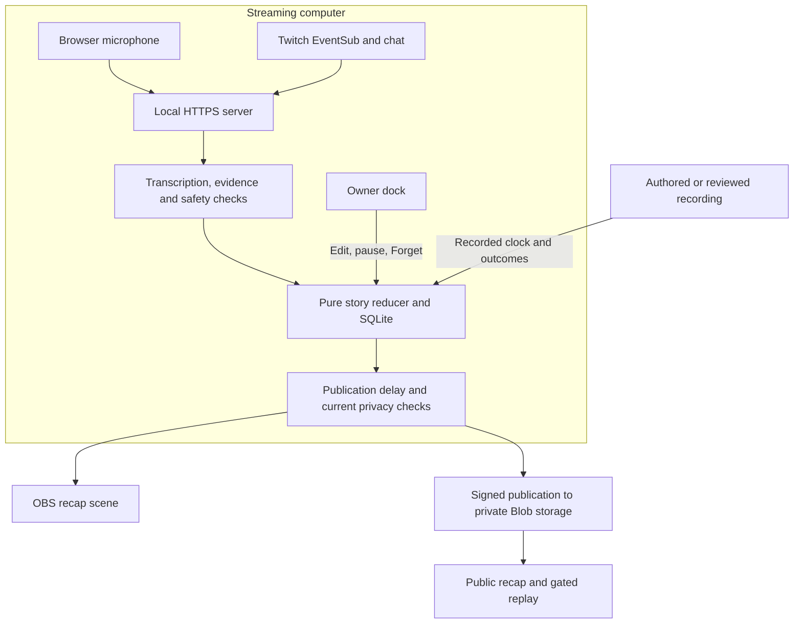

<p align="center"></p>

# Catch up with the stream while it keeps going

Previously gives late Twitch viewers the context behind the current moment. It turns spoken context and chat evidence into a short, editable stream history, then uses the published story to welcome an incoming raid in OBS. The streamer controls listening, corrections, and what gets forgotten.

[Open Previously](https://previously-seven.vercel.app). [Run the example](#try-the-authored-example). [Set up a channel](docs/setup/local.md). [Source repository](https://github.com/DarinaX2005X/previously-codex-twitchcon-project).

## Arrive in the middle and understand what changed

The included example follows a developer investigating an empty preview:

> “I am making notes survive a reload. The saved note is still in storage, but the preview is empty. I am checking the preview renderer.”

**The source gives the context.** A checked chapter explains what is happening and includes only details supported by the stream. This coding example has a goal and a current investigation; other streams can have different kinds of context. Chat reactions alone cannot establish that a problem was fixed.

**The chapter gives the arrival a story.** A raid triggers a prepared scene built from published context. An early arrival gets a shorter welcome when there is not enough story yet. A permitted previous-stream clip can accompany that welcome, with its origin made clear.

**The streamer can correct the story.** Editing a published chapter withdraws the previous wording immediately. The correction becomes an owner statement and waits for its own checks. Forget removes affected history and cancels dependent playback and queued work, including pinned material.

The shipped replay is an authored, text-only example. It contains no recorded streamer footage or actual model responses. Its raid illustrates the scene flow; it is not evidence of an incoming Twitch raid.

## Try the authored example

The local setup script supports Windows. Install Node.js 22.13 or newer with npm, then open the repository directory in PowerShell:

```powershell
npm ci
npm run setup:local
npm run build
npm run replay
```

The setup command creates local secrets and a localhost certificate. If Windows asks to trust it, confirm the **Previously localhost development** certificate for your current user. Existing nonempty settings are preserved.

Open [the local replay](https://localhost:4317/replay). This mode does not require Twitch, OpenAI, or Vercel accounts and does not create live side effects.

1. Select **Play recording**. The checked source publishes at recorded time **1:16**, after the same 75-second hold used by the live pipeline. **4×** advances recorded time faster.
2. Select **Jump to raid** to replay the prefix and see the welcome scene.
3. Select **Apply correction**, then **Preview next recap**. Switch between English and Russian to use the example's checked wording.
4. Open the **demo dock** to try your own edit. Wording without a recorded safety result stays held. **Restart** creates a fresh isolated run.

The [replay guide](docs/replay/README.md) explains isolation, provider fixtures, recordings, and offline copies. The [local setup guide](docs/setup/local.md) covers certificates, OBS, account setup, and troubleshooting.

## Use your own stream

Run `npm start` after building, then open [local channel setup](https://localhost:4317/setup). Configure the broadcaster's Twitch application, connect that account, and choose **Start listening** when ready. Listening does not start just because the server is running.

Use the dock to inspect sources, pin or correct chapters, save moments, pause listening, and apply Forget. **Preview recap** stays local; **Show recap** sends the prepared scene to the connected overlay. The public page exposes only published context, with source times and available official clip links.

New speech and story checks require a funded OpenAI account and the explicit paid-call switch. The repository defaults to paid calls off. Models and the persistent dispatch budget are described in the [configuration reference](docs/setup/configuration.md); account model access and live output quality must be checked with the intended channel.

Automatic Twitch clips are a separate choice. Twitch can create the clip before Previously's publication hold expires. Forget withdraws the material from Previously, but removing an external Twitch clip requires the channel's [clip manager](https://dashboard.twitch.tv/content/clips).

## How the story reaches viewers



The diagram separates private evidence on the streaming computer from published material available to viewers. Replay uses the same domain rules with recorded inputs and simulated external effects. See the [architecture guide](docs/architecture/README.md) for persistence, revision fences, and failure behavior.

The interface is English. English and Russian recap presentations are separate checked versions of the same evidence; recognition keeps the source language. A language switch waits for the complete requested presentation instead of mixing versions.

Publication normally waits 75 seconds after the end of its supporting material, configurable from 60 to 90 seconds. Safety checks and current privacy rules must also pass. A checked owner correction does not start another full hold. A local edit remains marked pending until the cloud acknowledges it.

## Technology and development

| Part | Role |
| --- | --- |
| TypeScript, React, Vite | Owner dock, public reader, setup, replay worker, and OBS scene renderer |
| Node.js, Express, native SQLite | Local HTTPS, encrypted authorization storage, evidence graph, durable jobs, and publication fences |
| Twitch EventSub and Helix | Stream identity, chat and moderation events, raid triggers, chat replies, and authorized clip operations |
| OpenAI adapters | Transcription, structured story and lore proposals, grounding review, privacy checks, moderation, and optional narration |
| Vercel Functions and private Blob storage | Signed publication, current public snapshots, revocable replay manifests, and gated asset reads |

Codex was used to implement the domain model, server adapters, interfaces, and integration tests, and to investigate failures across those boundaries. VibeMachina supplied planning, design, and review guidance; it is not a runtime dependency. The product uses local [Onest](public/fonts/OFL-Onest.txt) font assets under the SIL Open Font License. The [brand assets](public/brand/) share an outlined SVG source.

## Run checks and operate the app

```powershell
npm run check
npx tsx docs/setup/verify-keyless.mts
```

`npm run check` typechecks, runs tests, and builds both local and public clients. The keyless check uses a fresh temporary database and an ephemeral listener with the generated localhost certificate. It verifies HTTPS, readiness, manifest integrity, the authored chapter, and a raid plan with external fetches blocked. It can run alongside the collector.

Authored tests cover privacy races, durable owner review after restart, stale revisions, recorded replay, and public asset revocation. Separate [cloud checks](docs/testing/cloud-storage.md) exercise the real private store and deployed HTTP publication. These are different from a real-stream check of Twitch authorization, microphone capture, OBS audio routing, clip alignment, and model quality. The text example supplies none of that live evidence, and synthetic load checks do not establish eight hours of live reliability.

| Guide | What it covers |
| --- | --- |
| [Local setup](docs/setup/local.md) | Installation, Twitch connection, microphone, OBS, and recovery |
| [Configuration](docs/setup/configuration.md) | Effective environment variables, persistence, and provider defaults |
| [Public deployment](docs/setup/publication.md) | Vercel, private Blob storage, signed publishing, and revocation |
| [Architecture](docs/architecture/README.md) | Data flow, ownership, privacy, queues, and resource bounds |
| [Replay and recordings](docs/replay/README.md) | Authored fixtures, private capture, reviewed exports, and offline limits |

Private stream sources, credentials, captures, and local databases stay outside the public build and repository. Public replay needs a network connection to revalidate its manifest. Already downloaded copies, external clips, and other people's recordings cannot be recalled by a later Forget action.
